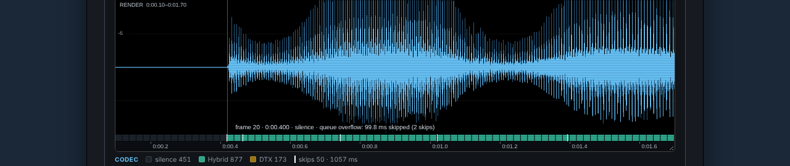
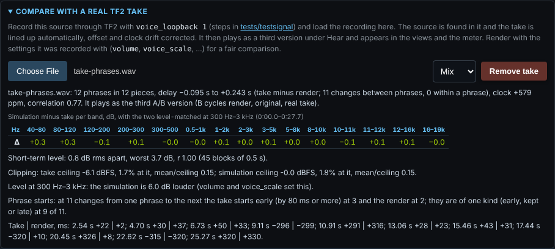

# W3-02e: the codec lane and the real-take panel on the game's voice queue

The builder's report. The order is part W3-02e of `docs/work-orders/W3-02ef-lane-and-flat-rule.md`, with its
rulings, the orchestrator's private look 1 and "After the plan review", which win over the text above them. Branch
`claude/w3-02e-lane-and-take`, from `main` at `c15a575` (cache v45), with `origin/main` merged twice: RP-01f, then W3-02f (`23ef54c`, cache v46).

**Status:** built, points 1 to 9 of "What changes". Every new check passes and each break of the order's table fails
the check it names. No render's samples change: no file under `engine/`, `audio.js`, `audio-worker.js`,
`live-worker.js`, `voice-channel.js`, `reference.js` or `constants.js` changed. None of the order's stop-and-ask
cases was met. Private look 2 (the count of phrase starts on a real take) is the orchestrator's and was not run.

## Commits

| Commit | What |
| --- | --- |
| `1d55dad` | the lane, its hover and legend (`app/visualizer.js`, `style.css`); the panel (`app/realtake.js`); [Browser 8f] in `tests/browser.verify.js` |
| `a4dcc1b` | `docs/PAGE.md`, `README.md`, `docs/ACCURACY.md`; the comment in `tests/reference.verify.mjs` |
| `2619c11` | `origin/main` (RP-01f) merged; it touches no file of this order |
| `7d8fb4a` | `origin/main` (W3-02f, the flat rule retired; cache v46) merged; it touches no file of this order |
| the last | this report and its pictures |

## What was built

A render is "on the queue" when its `codecInfo.channel` holds `source`, the played log's map (`laneOnQueue` in
`app/visualizer.js`). Every other render (the file's own timing, a demo's voice, the other codecs, a live take, the
codec skipped) keeps `main`'s lane, hover and legend; the browser suite holds main's hover text for three slots of a
render on the file's own timing character for character.

**The lane** (`app/visualizer.js`).
- `frameAt` and `frameStart` take the look-ahead from `laneLookahead(info)`: 0 on the queue, `info.lookahead`
  otherwise. Slot `f` of a render on the queue covers the render's `0.02 f` to `0.02 (f + 1)` s. The zoomed-out
  branch of `drawCodecLane`, which works out its frames itself, uses the same function (the plan review's point 5).
- `drawLaneSkips` draws, after the frames and in both branches, one mark 1 CSS pixel wide across the lane's whole
  height for each entry of `channel.drops` before the source's end (`laneSkips`: `time` below
  `state.renderedSource.duration`), on the whole pixel of its time; skips on one pixel draw once. The colour is
  `LANE_SKIP_COLOR`, white, which no kind of frame uses.
- `laneHoverText(info, t, halfPixel)` makes the lane's readout. Off the queue it is main's text. On the queue it is
  main's text (with `silence` for code 0), then `sent frame k` by the rule of `steamPlayedInfo`, then `the source's S
  s, M ms early` (or `late`, or `on time` under 0.5 ms) from the slot's centre, then `opened the queue` or `joined the
  queue`, then `queue overflow: N ms skipped` with `(n skips)` when more than one skip is drawn on the crosshair's
  pixel (since the fix round, by the drawing's own rule; `laneHoverAt`).
- The legend: on the queue code 0 reads `silence` with the title the order gives, the heading's title says the lane
  shows what plays in each 20 ms of the render, and an item `skips N · M ms` follows the kinds of frame when a skip is
  heard. Its swatch is `.lg-mark` (a new rule in `style.css`), not `.lg-box`, so the checks that add up the boxes'
  counts are unchanged.

**The panel** (`app/realtake.js`).
- `renderGuide()` gives the render's `channel.spurts` as `spurts` (or null). `locateTake` takes it out of the options
  handed to `track()` and returns it; `state.realTake.guideSpurts` keeps it with the aligned take.
- `describeTiming`: no "latency trims" and no `256 / 44100`; `N phrases in M pieces`, the bracket `take minus render`
  or `take minus source` with `B changes between phrases, W within a phrase`; ", lined up against the render" gone.
  The comment above it says what the engine does (finding 10).
- `changeAt`, `phraseChanges` and `phraseStartLines` as the order's points 6 and 7 and the plan review's point 7 say:
  `guideMs` 0 with no guide phrases; `takeMs` and `takeKind` null when `guideMs` is null from a null offset, shown as
  `—` and left out of T and G. `updateReferenceReport` adds the two lines after its others. The sentence has three
  forms: a render with `channel.spurts` (the order's first), a render with no `channel` (the order's second), and a
  `channel` with no `spurts` ("This render ran the game's voice queue and does not say which of its phrases start
  early.", the plan review's point 8; no render of today has it).
- Nothing changed in what `tests/accuracy.mjs` reads: `renderOptions`, `takeChannel` and `takeTrackOptions` are as on
  `main`, and the take is lined up as before.

**The documents.** `docs/PAGE.md` (the lane on the queue; the status line; phrase starts), `README.md:94` and
`docs/ACCURACY.md:31` (what is not exact in the panel now, with private look 1's table as the order gives it, measured
and private), and the comment of `tests/reference.verify.mjs` above the 5.8 ms check (the check is unchanged).
`docs/ACCURACY.md:158` stays (ruling 6).

## Wording chosen within the order

- The hover says `sent frame k`, not `frame k`, beside the slot's own `frame f`, so the two numbers cannot be taken
  for one.
- The source's second is given wherever `channel.source[f]` is not -1; the sent frame's number only where the played
  code is not 0 as well (since the fix round; before it the number was given on such slots too). At the first slot of
  a phrase the played log can hold 0 while the source plays: the slot's centre maps into the sent frame just before
  the first coded one (the look-ahead). On the suite's render the joined phrase's first slot now reads
  `frame 448 · 0:08.960 · silence · the source's 9.273 s, 303.0 ms early · joined the queue`.
- In the line of changes a negative figure has the page's minus sign `−`, as the status line and the band table have.

## The checks ([Browser 8f], `verifyLaneAndTake`)

The source is the plan review's twelve phrases (`wavPhrases`, 30 s at 48 kHz, through a 16-bit WAV). In the browser,
at the page's defaults (the game's queue, 300 frames a second, `voice_buffer_ms` 100, the engine's own seed): 12
phrases of the sender, 3 joined the queue, phrases 5 and 11 start early, 50 skips heard, as the planner measured in
Node. The take is `TF2Audio.process` of the source with `renderOptions()` and the first seed from 1 at which some
pause has another kind of change; seed 1 was taken, at which phrases 5, 9 and 11 start early (as in Node). It is
delayed 0.25 s, at half level, written at the render's rate.

| Order's check | What the suite holds |
| --- | --- |
| 1 | `frameStart(info, f)` is `0.02 f` and `frameAt(info, 0.02 f + 0.01)` is `f` for all 1501 slots; at 10.1 ms a pixel (aggregated) the first frame pixel of each of nine phrases is the first pixel at or after `frameStart` of its first played slot; on the file's own timing both functions keep the look-ahead |
| 2 | over the whole render and zoomed into the first second, the mark's colour is at the pixel of every heard skip and at no pixel more than one away; none on the file's own timing; a 1 s tone with room 6 (render 2.50 s) has one skip past the end, at 1.0217 s, 19.9 ms, with no mark, and the legend counts the 4 heard |
| 3 | the joined phrase's first slot: the source's second, 303.0 ms early (within 1 ms of the rule), `joined the queue` (and, since the fix round, no sent frame's number, its played code being 0); at the pixel with the most skips (2, 99.8 ms) their sum and count, and at a lone one its ms alone; an empty slot reads `silence` and has no number; on the file's own timing main's text for three slots |
| 4 | `skips 50 · 1057 ms`, `silence 451`, no `not sent`, the heading's title on the queue; on the file's own timing no skips item, `not sent`, main's title; a `channel` without `source` keeps the look-ahead, `not sent` and no marks |
| 5 | lined up against the render: `take minus render; 11 changes between phrases, 0 within a phrase`, `phrases`, no `5.8`, `trim` or `re-timing`; lined up after a render with loss: `take minus source` |
| 6 | for each of 11 changes `takeKind` is the kind of `changeAt(X, at)`, `renderKind` that of `changeAt(Y, at)`, and `takeMs` within 60 ms of `changeAt(X, at)` (worst 33 ms); the take starts 17.44 s early and the render keeps it; `changeAt` on lists made by hand; the sentence's N, T, R, G and the line's times; after a render with 20% loss at 67 frames a second (the order's added case) the take is not lined up again and its kinds still hold from the render it was lined up with, while R comes from the render on screen; after `voice_timeline source` the take is lined up again with `guideSpurts` null, its kinds still hold and the sentence is the second form |

The panel on the suite's take, against the render on the queue:

> Phrase starts: at 11 changes from one phrase to the next the take starts early (by 80 ms or more) at 3 and the
> render at 2; they are of one kind (early, kept or late) at 9 of 11.
>
> Take | render, ms: 2.54 s +22 | +2; 4.70 s +30 | +37; 6.73 s +50 | +33; 9.11 s −296 | −299; 10.91 s +291 | +316;
> 13.06 s +28 | +23; 15.46 s +43 | +31; 17.44 s −320 | +10; 20.45 s +326 | +8; 22.62 s −315 | −320; 25.27 s +320 | +330.

Each change of the take against its truth (its own phrases): −296/−270, +291/+298, −320/−304, +326/+319, −315/−312,
+320/+334 at the six changes of 80 ms or more, and under 33 ms off at the five kept (measured on the model, in the
browser). After 17.44 s the take's pause comes back at 20.45 s (late +326) while the render keeps both.

## The pictures

From the suite's own signal and take (a scratch script outside the repository drove the page the same way):
- `W3-02e/desktop-lane-legend.png` and `W3-02e/phone-lane-legend.png`: the first phrase, 0.10 to 1.70 s, with the
  marks of its skips and the hover on the mark at 0.400 s (`queue overflow: 99.8 ms skipped (2 skips)`), and the
  legend with `silence 451` and `skips 50 · 1057 ms`. `W3-02e/desktop-lane.png` and `W3-02e/phone-lane.png` are the
  canvas alone.
- `W3-02e/desktop-panel.png` and `W3-02e/phone-panel.png`: the panel with the status line, the report and the two
  lines on phrase starts. The status line there reads `clock +579 ppm`: on the suite's 30 s of short phrases the
  clock's fit varies by several hundred parts in a million (+579 and −83 at seeds 1 and 2, measured by the reviewer on
  the model), and "near 0" holds on a take of some length. The pictures were taken before the fix round; its changes
  do not show in them.

## The breaks

Each break was put into the code alone and the section run with the checks made non-fatal (a scratch runner), so
every check a break fails is listed. The code was restored after each.

| Break | Checks that failed |
| --- | --- |
| the played slot keeps the look-ahead | 1: every slot's place (wrong from slot 0); the first frame pixel of each phrase |
| the look-ahead dropped for every render | 1, its second half: on the file's own timing the look-ahead is kept; also main's hover text on the file's own timing, and the `channel` without `source` |
| the zoomed-out branch keeps the look-ahead (the plan review's point 5) | 1: the first frame pixel of each phrase (slot 142 at pixel 40, want 41) |
| a skip past the source's end is drawn | 2: the tone with a room |
| no mark is drawn | 2: the whole render, the first second, the tone with a room |
| each mark drawn one slot (20 ms) late | 2: the whole render, the first second, the tone with a room |
| the hover's `early` figure made from the slot's start, not its centre | 3: the joined phrase's first slot |
| the hover's skip text takes one entry where two share a pixel | 3: the mark with two skips |
| `silence` on every render | 4: the file's own timing's legend; also main's hover text, and the `channel` without `source` |
| the status line always says `take minus source` | 5: lined up against the render |
| `takeMs` without `guideMs` | 6: each change's kinds (the changes at 9.11 s and 22.62 s, early in the take and the render, and at 10.91 s and 25.27 s, late in both, read kept); also the case after the render with loss |
| `guideMs` from the render on screen, not the render the take was lined up with | 6: the case the builder added (a render with 20% loss at 67 frames a second after the alignment) |
| `changeAt` without the 0.2 s limit | 6: the lists made by hand |

## Done means

Run on the merged head `7d8fb4a` (with W3-02f), each heavy run under `flock /tmp/tf2ve-heavy.lock`.

| Order's point | Command | Last lines |
| --- | --- | --- |
| 1 to 6 | the browser suite, [Browser 8f] | every check of the section `ok` (the table above) |
| 7 | `git diff origin/main...HEAD --stat` | `README.md`, `app/realtake.js`, `app/visualizer.js`, `docs/ACCURACY.md`, `docs/PAGE.md`, `style.css`, `tests/browser.verify.js`, `tests/reference.verify.mjs`, and this report with its pictures; `git diff origin/main --stat -- engine audio.js audio-worker.js live-worker.js voice-channel.js reference.js constants.js sw.js` prints nothing |
| 8 | `flock /tmp/tf2ve-heavy.lock pnpm test` | `27 of 27 suites passed. 1024.0 s summed` (also passed before the merge of W3-02f, at `a4dcc1b`) |
| 9 | `CHROMIUM_EXECUTABLE=… flock /tmp/tf2ve-heavy.lock pnpm test:browser` | `browser  browser  passed  409.5`, `1 of 1 suites passed` (also passed before the merge of W3-02f) |
| 10 | CI's `verify` on the pushed head | read after the push; the hand-back gives it |
| 11 | this report | the pictures, the breaks, the seeds, what was not done |

The existing checks the order names under "What must not move" ([Browser 3d], the demo's, Speex's, `miles`'s, the live
take's, the take checks of [Browser 3e] and [Browser 7]) pass untouched; no recorded value of any suite changed.

## The fix round (2026-11-14)

The review (merge after fixes) and the orchestrator's private look 2 are in the order's last section. `origin/main`
(that section) was merged first (`ffe4530`, documents only). The fixes are `6f4f4bb`.

| Point | What changed | Check in [Browser 8f] |
| --- | --- | --- |
| 1 | nothing in the code; the checks were missing | the status line's `between` and `within` against the take's pieces (11 and 0 on the suite's take), on the guided and the unguided take; each entry of the list under "Phrase starts" as `at s ms(takeMs) \| ms(renderMs)`, on the queue and on the file's own timing |
| 2 | `skipPixel` is the marks' one pixel rule; `laneHoverAt(w, range, x)`, which `drawHover` calls, hands `laneHoverText` the crosshair's pixel `round(x)`, and the hover names the skips drawn there. Without a view (a direct call) it keeps the half-pixel rule | the hover at every whole pixel of the whole view: each pixel drawn in the mark's colour names the skips drawn on it, summed and counted (44 marked pixels, 6 with more than one skip); every other pixel names none |
| 3 | a slot whose played code is 0 shows no sent frame's number; it keeps the source's second, how early and joined | the joined phrase's first slot (code 0) has no number; every slot that plays the source with code 0 (3) has none and keeps the source's second |
| 4 | none | the number on every played slot (1050), 245 of them 324 samples or more into their 480-sample frame at 24 kHz |
| 5 | "near 0 on a take of some length" in `README.md`, `docs/ACCURACY.md` and `docs/PAGE.md`, with the review's +579 and −83; the picture's caption here | none (words) |

Private look 2 also changed what the documents could say: "the count was checked … not on a recording" was no longer
true. `README.md`, `docs/ACCURACY.md` and `docs/PAGE.md` now say it was checked on the owner's speech take, where T
equals `tests/retiming.mjs`'s count on both timings (measured, private), with the look's 7 of 9 and its two changes
either side of the limit in `docs/ACCURACY.md`.

The breaks of the fix round, each alone, with the checks made non-fatal:

| Break | Checks that failed |
| --- | --- |
| B1: the `between` test inverted | 1: the status line lined up against the render, and the one against the source |
| B2: the list prints `stepMs` for `takeMs` | 1: the sentence and the list of changes |
| the hover by half a pixel from the pointer's time (the review's 103 of 220) | 2: the hover at every whole pixel |
| the sent frame's number on a played code 0 | 3: the joined phrase's first slot; the slots with code 0 |
| B4: the look-ahead dropped from the number | 4: the number on every played slot |
| the early figure from the slot's start (again) | 3: the joined phrase's first slot |
| one skip where two share a pixel (again) | 2: the hover at every whole pixel |

The done-means again, on `6f4f4bb`, each heavy run under `flock /tmp/tf2ve-heavy.lock`:
- `pnpm test`: `27 of 27 suites passed. 1081.1 s summed`.
- `CHROMIUM_EXECUTABLE=… pnpm test:browser`: `browser  browser  passed  426.6`, `1 of 1 suites passed`.
- `git diff origin/main...HEAD --stat`: the same eight files as before, with this report and its pictures; nothing
  under `engine/`, and `sw.js` untouched.
- CI's `verify` on the pushed head: given in the hand-back.

## Seen and not changed

- The suite's take, a render on the queue at another seed and no clock change, reads `clock +579 ppm` lined up against
  the render on the queue and `+572 ppm` lined up against the source (measured on the model, in the browser). The
  planner's expectation for a real take against a render on the queue is near 0. The review measured the fit varying by
  several hundred parts in a million on this short a take (+579 and −83 at seeds 1 and 2); the documents now say "near
  0" for a take of some length. No check depends on it.
- The order's figure "176 of 176" is the planner's; this build's check holds the rule on one take (11 changes).

## Not done

- Private look 2 (the orchestrator's, on the branch before the merge).
- Nothing else of points 1 to 9 was left out. A live take with a `channel` and no `source` cannot be made on the page
  today (W3-02c-3b, not built yet); the suite holds the rule with a copy of a render's `codecInfo` whose `channel` has
  counts alone.

## Hard rules

The branch's diff and its commit messages were scanned for recordings, personal details, SteamIDs and model names:
none (the trailer lines aside). The pictures are of the suite's synthetic signal. `sw.js` is unchanged: no file the
site loads was added or renamed. `node tests/cache-number.mjs origin/main --report` on the merged head: "cached files changed since origin/main (23ef54c): app/realtake.js, app/visualizer.js, style.css; cache number against origin/main (23ef54c): the number is v46, not above v46: it must rise". The orchestrator sets it at the merge.
